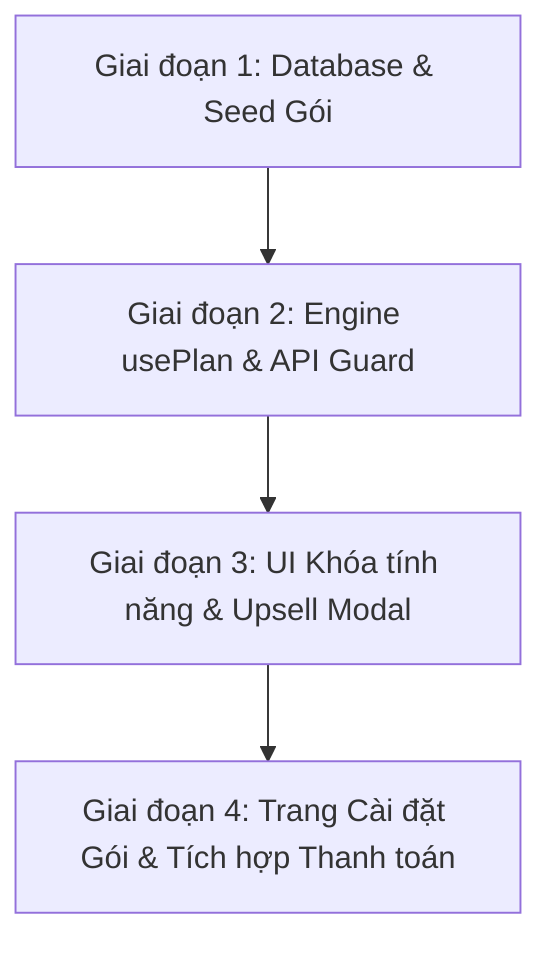

# 📋 KẾ HOẠCH THIẾT KẾ & TRIỂN KHAI MÔ HÌNH SUBSCRIPTION (FREE - PRO - ULTRA) CHO GLOPRO

> **Tài liệu:** `docs/PLAN-subscription-tiers.md`  
> **Phiên bản:** 1.0 (Master Plan)  
> **Trạng thái:** Chờ duyệt (Pending Approval)  
> **Phạm vi:** Database Schema, Feature Gating Engine, Frontend UI/UX, Quota Limits & Billing Webhook.

---

## 🎯 1. TỔNG QUAN CHIẾN LƯỢC MÔ HÌNH GÓI (SUBSCRIPTION TIERS)

Mô hình định giá dạng **Freemium & Tiered SaaS** dành cho các Salon / Spa:

```
┌─────────────────────────────────────────────────────────────────────────────┐
│                       GLOPRO SUBSCRIPTION TIERS                            │
├─────────────────────┬───────────────────────────┬───────────────────────────┤
│    🌱 GÓI FREE      │       ⭐ GÓI PRO          │       💎 GÓI ULTRA        │
│  (Cơ bản / Miễn phí) │  (Nghiệp vụ nâng cao)    │   (Toàn diện & AI Brain)  │
├─────────────────────┼───────────────────────────┼───────────────────────────┤
│ • Dành cho tiệm nhỏ │ • Dành cho Salon/Spa vừa  │ • Dành cho Chuỗi & Salon  │
│   hoặc mới mở       │   cần tối ưu nghiệp vụ    │   cao cấp muốn tự động hóa│
│ • 0 VNĐ/tháng       │ • 399.000 VNĐ/tháng       │ • 899.000 VNĐ/tháng       │
│ • 1 Chi nhánh       │ • Tối đa 3 Chi nhánh      │ • Không giới hạn Chi nhánh│
│ • Tối đa 5 KTV/NV   │ • Tối đa 20 KTV/NV        │ • Không giới hạn KTV/NV   │
│ • Nghiệp vụ lõi     │ • Full nghiệp vụ quản trị │ • Toàn năng + Full AI     │
└─────────────────────┴───────────────────────────┴───────────────────────────┘
```

---

## 📊 2. MA TRẬN PHÂN CHIA TÍNH NĂNG (FEATURE MATRIX)

| Nhóm chức năng | Tính năng chi tiết | 🌱 Free | ⭐ Pro | 💎 Ultra | Cơ chế kiểm soát |
|---|---|:---:|:---:|:---:|---|
| **Cơ sở & Quy mô** | Số lượng chi nhánh | 1 | 3 | ∞ | Branch Guard (Chặn nút Tạo chi nhánh) |
| | Số lượng nhân viên / KTV | 5 | 20 | ∞ | Quota Guard (Chặn nút Thêm NV) |
| | Giới hạn lịch hẹn / tháng | 100 | ∞ | ∞ | Booking Quota Guard |
| **Vận hành Lõi** | Đặt lịch hẹn & Lịch biểu | ✅ | ✅ | ✅ | Miễn phí |
| | Hồ sơ khách hàng cơ bản | ✅ | ✅ | ✅ | Miễn phí |
| | Thu ngân POS & In hóa đơn | ✅ (Cơ bản) | ✅ (Nâng cao) | ✅ (Full) | Free không có gộp hóa đơn/chia tiền |
| | Báo cáo doanh thu cơ bản | ✅ (Theo ngày) | ✅ (Đầy đủ) | ✅ (Đầy đủ) | Free xem 7 ngày gần nhất |
| **Nghiệp vụ Chuyên sâu** | Sơ đồ Phòng & Giường 3D | ❌ Khóa | ✅ | ✅ | Hiển thị Banner nâng cấp Pro |
| | Quản lý Kho & Nhà cung cấp | ❌ Khóa | ✅ | ✅ | Khóa Menu Kho |
| | Tính Hoa hồng KTV & Bảng lương | ❌ Khóa | ✅ | ✅ | Khóa Menu Bảng lương |
| | Gói liệu trình, Membership, Thẻ trả trước | ❌ Khóa | ✅ | ✅ | Khóa chức năng Package |
| | Quản lý Dòng tiền (Thu / Chi) | ❌ Khóa | ✅ | ✅ | Khóa Menu Dòng tiền |
| | Tùy biến Theme & Widget giao diện | ❌ Khóa (Mặc định) | ✅ (Full Theme) | ✅ (Full Theme) | Khóa Tab Giao diện nâng cao |
| **Trí tuệ nhân tạo (AI)** | **GloPro AI** (Trợ lý điều hành) | ❌ Khóa | ❌ Khóa | ✅ | Hiển thị Drawer giới thiệu Ultra |
| | **AI Customer Segmentation** (Phân nhóm tự động) | ❌ Khóa | ❌ Khóa | ✅ | Khóa Tab AI Phân khúc |
| | **AI Revenue Forecasting** (Dự báo doanh thu) | ❌ Khóa | ❌ Khóa | ✅ | Khóa Widget AI Dự báo |
| | **Social Chat AI Translator** (Dịch đa ngôn ngữ) | ❌ Khóa | ❌ Khóa | ✅ | Khóa AI Translate trong Social Chat |
| | **AI Marketing Campaign** (Gợi ý chiến dịch) | ❌ Khóa | ❌ Khóa | ✅ | Khóa tính năng AI Marketing |

---

## 🗄️ 3. THIẾT KẾ DATABASE (SUPABASE SCHEMA)

Thêm 2 bảng mới được bảo vệ bởi RLS trong database:

```sql
-- 1. Bảng lưu trữ gói dịch vụ (Subscription Plans)
CREATE TABLE public.subscription_plans (
    id VARCHAR(50) PRIMARY KEY, -- 'free', 'pro', 'ultra'
    name VARCHAR(100) NOT NULL,
    price NUMERIC(12, 2) NOT NULL DEFAULT 0,
    billing_cycle VARCHAR(20) DEFAULT 'monthly', -- 'monthly', 'yearly'
    max_branches INT NOT NULL DEFAULT 1,
    max_staff INT NOT NULL DEFAULT 5,
    max_appointments_per_month INT DEFAULT 100,
    features JSONB NOT NULL DEFAULT '[]'::jsonb,
    is_active BOOLEAN DEFAULT true,
    created_at TIMESTAMP WITH TIME ZONE DEFAULT CURRENT_TIMESTAMP
);

-- 2. Bảng đăng ký gói của từng Salon (Tenant Subscriptions)
CREATE TABLE public.tenant_subscriptions (
    id UUID PRIMARY KEY DEFAULT gen_random_uuid(),
    tenant_id UUID NOT NULL UNIQUE,
    plan_id VARCHAR(50) NOT NULL REFERENCES public.subscription_plans(id) DEFAULT 'free',
    status VARCHAR(30) NOT NULL DEFAULT 'active', -- 'active', 'trialing', 'past_due', 'canceled'
    current_period_start TIMESTAMP WITH TIME ZONE DEFAULT CURRENT_TIMESTAMP,
    current_period_end TIMESTAMP WITH TIME ZONE, -- NULL nếu là gói free vĩnh viễn
    cancel_at_period_end BOOLEAN DEFAULT false,
    payment_method VARCHAR(50), -- 'vietqr', 'stripe', 'vnpay'
    created_at TIMESTAMP WITH TIME ZONE DEFAULT CURRENT_TIMESTAMP,
    updated_at TIMESTAMP WITH TIME ZONE DEFAULT CURRENT_TIMESTAMP
);

-- Kích hoạt RLS
ALTER TABLE public.subscription_plans ENABLE ROW LEVEL SECURITY;
ALTER TABLE public.tenant_subscriptions ENABLE ROW LEVEL SECURITY;

CREATE POLICY "subscription_plans_read_all" ON public.subscription_plans FOR SELECT USING (true);
CREATE POLICY "tenant_subscriptions_tenant_isolation" ON public.tenant_subscriptions 
    FOR SELECT USING (tenant_id = public.current_tenant_id());
```

---

## 🛡️ 4. KIẾN TRÚC KIỂM SOÁT TÍNH NĂNG (FEATURE GATING ENGINE)

### 4.1. Hook Kiểm Tra Quyền Hạn ở Frontend (`usePlanGuard`)
Tạo một Custom Hook linh hoạt tại `src/lib/usePlanGuard.js`:

```javascript
// Ví dụ sử dụng:
const { plan, hasFeature, canAddStaff, canAddBranch, openUpgradeModal } = usePlan();

// Kiểm tra tính năng:
if (!hasFeature('ai_copilot')) {
  openUpgradeModal({ 
    feature: 'AI Copilot', 
    requiredPlan: 'ultra', 
    reason: 'Trợ lý AI phân tích và ra lệnh tự động dành riêng cho gói Ultra.' 
  });
}
```

### 4.2. Thành phần Khóa Giao Diện Khéo Léo (`<FeatureLockGate>`)
Thay vì ẩn hoàn toàn khiến khách không biết sản phẩm có tính năng đó, hiển thị **Giao diện dạng làm mờ (Glassmorphism Blur) kèm nút "Mở khóa gói Pro / Ultra"**:
- Người dùng bấm vào nút Khóa -> Mở Modal so sánh gói và bảng thanh toán quét mã VietQR tự động.

### 4.3. Bảo vệ Backend API & PostgREST (`src/app/api/...`)
- API `/api/copilot`: Kiểm tra `tenant_subscriptions.plan_id === 'ultra'`. Nếu là Free hoặc Pro, từ chối thực hiện tác vụ AI (`403 Forbidden: Yêu cầu nâng cấp gói Ultra`).
- API `/api/db` (Hành động Tạo chi nhánh / Tạo KTV): Kiểm tra tổng số lượng hiện có so với hạn mức gói của Salon (`max_branches`, `max_staff`).

---

## 🎨 5. THIẾT KẾ GIAO DIỆN & TRẢI NGHIỆM NGƯỜI DÙNG (UI/UX)

1. **Thanh Header TopBar:**
   - Hiển thị Badge Gói dịch vụ cạnh tên Salon (Ví dụ: `🌱 Free`, `⭐ Pro`, `💎 Ultra`).
   - Bấm vào Badge -> Mở ngay trang Quản lý gói cước.
2. **Trang Bảng Giá & Nâng Cấp (`/settings?tab=subscription`):**
   - Thiết kế 3 cột thẻ giá sang trọng (No-Purple theo quy chuẩn thiết kế GloPro: Slate, Emerald, Cyan/Blue, Gold).
   - Nút bật chu kỳ thanh toán: **Thanh toán hàng tháng** vs **Thanh toán hàng năm (Tiết kiệm 20%)**.
   - Nút nâng cấp: Tích hợp Popup quét mã QR VietQR chuyển khoản tự động (Webhook kích hoạt gói tức thì sau 3 giây).
3. **Modal "Mở Khóa Tính Năng" (Upsell Modal):**
   - Xuất hiện khi bấm vào Phòng Giường 3D, AI Copilot, Bảng Lương hoặc Kho đối với tài khoản Free.
   - Trình bày trực quan giá trị tính năng mang lại cho Salon kèm nút dùng thử hoặc nâng cấp ngay.

---

## 🚀 6. LỘ TRÌNH TRIỂN KHAI (4 GIAI ĐOẠN)



### Giai đoạn 1: Cơ sở dữ liệu & Cấu hình Gói cước (Database & Data)
- [ ] Viết migration tạo 2 bảng `subscription_plans` và `tenant_subscriptions`.
- [ ] Seed sẵn dữ liệu mẫu cho 3 gói (`free`, `pro`, `ultra`).
- [ ] Gán mặc định gói `free` cho tất cả các salon hiện tại (hoặc kích hoạt `ultra` cho các salon thử nghiệm như salon của Đức Live).

### Giai đoạn 2: Bộ máy kiểm soát quyền hạn (Guardrail Core)
- [ ] Tạo `src/lib/planConfig.js`: Định nghĩa bảng mã tính năng và hạn mức.
- [ ] Tạo `src/lib/PlanContext.jsx` & Hook `usePlan()`.
- [ ] Bổ sung kiểm tra quyền trong `/api/copilot` (Chỉ gói Ultra mới được gọi Gemini).
- [ ] Bổ sung kiểm tra hạn mức chi nhánh và nhân viên trong `/api/db`.

### Giai đoạn 3: Giao diện Khóa & Modal Nâng Cấp (UI Upsell)
- [ ] Xây dựng Component `<UpgradeModal />` (Hiển thị quyền lợi, bảng giá và nút thanh toán).
- [ ] Xây dựng Component `<FeatureLockGate />` bọc các tính năng:
  - Tab 3D Phòng Giường (`Bed3DViewer`)
  - Menu Kho & Nhà Cung Cấp
  - Menu Bảng Lương & Hoa Hồng KTV
  - Nút kích hoạt AI Copilot Drawer
- [ ] Thêm Badge hiển thị gói (`Free`, `Pro`, `Ultra`) trên Header `TopBar.jsx`.

### Giai đoạn 4: Cổng Thanh Toán & Quản Lý Gói (Billing & Checkout)
- [ ] Tạo tab "Gói cước & Đăng ký" trong `src/views/Settings.jsx`.
- [ ] Tích hợp tính năng tạo mã VietQR SePay/PayOS tự động theo cú pháp `GLOPRO {TENANT_ID} {PLAN}`.
- [ ] Viết API Webhook `/api/billing/webhook` để tự động nâng cấp gói khi tiền vào tài khoản.

---

## ❓ 7. CÂU HỎI LÀM RÕ (SOCRATIC GATE)

Trước khi tiến hành viết mã triển khai, xin ý kiến phản hồi của bạn về 3 điểm sau:

1. **Chính sách tài khoản hiện tại:** Salon hiện tại của bạn (`duclivegiolinh@gmail.com`) có mặc định được kích hoạt vĩnh viễn gói **Ultra (Full quyền AI)** không?
2. **Hình thức thanh toán:** Bạn muốn tích hợp cổng thanh toán nào trước? (Ví dụ: **Chuyển khoản VietQR tự động qua SePay/PayOS** hay **Thẻ quốc tế Stripe**)?
3. **Thời gian dùng thử (Trial):** Khách mới đăng ký có được tặng 7 hoặc 14 ngày dùng thử miễn phí gói **Pro/Ultra** trước khi quay về gói Free không?
